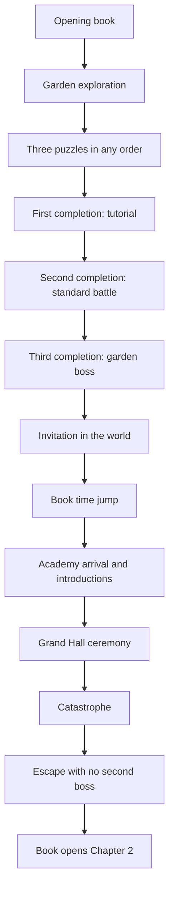

# When the Flowers Fade — Game Plan

**Status:** Preproduction / initial prototype planning  
**Drafted:** 2026-11-13  
**Authority:** Owner blueprint, recorded here and in `GAME_DESIGN.md`, `CHAPTER_01.md`, and `TASKS.md`.

This document is the project vision, technical architecture, phase plan, and decision log. Gameplay rules live in `GAME_DESIGN.md`. Chapter 1's order lives in `CHAPTER_01.md`. Task status lives in `TASKS.md`.

## 1. Vision

**When the Flowers Fade** is an original single-player, story-driven fantasy RPG. The player controls Orin, a gifted magic user whose power is expressed through flowers. The story is linear. There are no branching dialogue choices or alternate endings.

The game opens in color, beauty, and possibility. As Orin loses people and gains power, flowers, magic, and Orin's appearance become darker and less colorful. The change is gradual. By the ending, Orin resembles the antagonist whose actions set the story in motion. That antagonist's identity stays concealed until the intended reveal.

**Primary themes:** beauty and impermanence; the consequences of power; loss and change; identity; memory; the deterioration of innocence; creation and destruction.

**Genre:** Story-driven fantasy RPG with tactical combat, environmental puzzles, and exploration.  
**Perspective:** 3D isometric.  
**Estimated length:** 10–12 hours.  
**Structure:** 10 chapters, primarily linear.

### Two implementations

| Implementation | Role |
|---|---|
| Browser prototype | The current project. It demonstrates gameplay in a browser and is the implementation these documents govern. |
| Unreal Engine 5 | A possible future rebuild. It is not part of this repository and is not a reason to change prototype mechanics. |

The prototype must stand on its own. It must not require Unreal Engine, Unity, or a downloadable desktop build.

## 2. Design pillars

These are constraints, not aspirations.

1. **Story is fixed.** Do not add branches, optional recruits, or alternate endings.
2. **The book is narration only.** Play happens in the 3D world. See `GAME_DESIGN.md` §3.
3. **Puzzles live in the environment.** They are not separate minigames and not book pages.
4. **Puzzle completion leads to scripted combat.** Chapter 1 is the documented exception to where the boss sits in the chapter, not an exception to "three puzzles, three encounters."
5. **Combat is turn-based, tactical, and infrequent.** No random encounters. No flanking. No mid-battle revive. No free retreat unless escape is the encounter objective.
6. **No inventory economy.** No currency, loot, gear, or crafting. No conventional minimap, objective compass, or constant waypoint arrows.
7. **Companions are story-locked.** Maximum party size is five, including Orin. Exploration controls Orin only. Combat controls every active member. Dead companions take their abilities with them. Orin does not inherit those abilities.
8. **Working play before polish.** Placeholder geometry is correct until a system works.

## 3. Technical architecture

### 3.1 Technology

| Concern | Choice |
|---|---|
| 3D rendering | Three.js |
| Gameplay code | JavaScript |
| Dev server and build | Vite |
| Interface | HTML/CSS |
| Source control | GitHub |
| Intended hosting | Vercel |

Package versions are chosen when the Vite project is initialized, not before that milestone is approved. The build must stay compatible with Vercel. Do not deploy without explicit owner authorization.

### 3.2 System boundaries

Keep these separate. A feature may call another system; it should not absorb that system's rules.

| System | Responsibility |
|---|---|
| Core | Initialization, main loop, scene lifetime. |
| Rendering | Three.js renderer, lights, placeholder materials. |
| Camera | Isometric follow, rotation, zoom, pan where appropriate. |
| Input | Pointer and UI input. Click-to-move is the primary world movement. |
| Movement | Destination selection, path following, collision, facing. |
| Characters | Orin and companion entities, visual state, follow behavior. |
| World | Environments, collision geometry, landmarks. |
| Interaction | Use, examine, and story interactions. No inventory screen. |
| Puzzles | Shared puzzle rules: objective, reset, completion, one-time rewards. |
| Combat | Turns, initiative, AP, movement, victory, encounter scripting. |
| Abilities | Definitions for attacks, magic, cooldowns, friendly fire, ultimates. |
| Enemy AI | Tactical behavior profiles. No full attack preview for the player. |
| Progression | XP, levels, skill points, difficulty modifiers. |
| Dialogue | In-world conversations. Not book captions. |
| Story | Ordered story events and triggers. |
| Book | Illustrated page presentation and time jumps. |
| Saving | Autosave, manual slots, boss phase checkpoints. |
| UI | HUD presets, tutorials, encyclopedia, warnings. |
| Audio | Music, effects, and voice when those assets exist. |
| Data | Authored definitions for abilities, encounters, puzzles, and events. |
| Chapters | Chapter-specific composition of the systems above. |

Prefer data-driven definitions for puzzles, abilities, encounters, and story events so Chapter 1 content is not hard-coded into engine systems.

### 3.3 Directory structure

```text
src/
  core/
  rendering/
  camera/
  input/
  movement/
  characters/
  world/
  interaction/
  puzzles/
  combat/
  abilities/
  progression/
  dialogue/
  story/
  saving/
  ui/
  audio/
  data/
  chapters/
    chapter01/
public/
  assets/
    models/
    textures/
    audio/
    illustrations/
```

This tree is the planned layout. Create folders when the milestone that needs them is approved. Document any structural change in the decision log.

### 3.4 Prototype art

The intended final style is painterly, hand-crafted, and fantasy-inspired: colorful early, darker and less saturated later. The prototype uses procedural geometry and placeholder materials until gameplay for that area works. Do not block Milestone 1 on custom models or final illustrations.

Chapter 1 presents early Orin: bright color and floral magic. Do not start the monochrome transformation in this chapter.

### 3.5 Chapter and encounter flow

Later chapters use this loop: explore, interact, solve puzzles in flexible order, fight the scripted encounter each puzzle starts, learn more, solve the chapter's final puzzle, fight that chapter's boss, then transition through the book.

Chapter 1 does not end on its boss. The boss is the third childhood-garden encounter. The chapter continues through invitation, time jump, academy, catastrophe, and escape. Details and prohibitions are in `CHAPTER_01.md`.



## 4. Development phases

Build the smallest testable slice of each milestone. Do not start a major milestone until the previous one is verified and the owner approves the next.

| Milestone | Name | Outcome |
|---|---|---|
| 0 | Planning | These documents exist and the owner has approved them. |
| 1 | Playable 3D garden | Browser movement and one interaction in the garden. |
| 2 | Petal Streams | One solvable, resettable puzzle. |
| 3 | Basic combat | One winnable Garden Guardian tutorial. |
| 4 | Remaining puzzles | Fountain and Memory Flowers, any order. |
| 5 | Encounter progression | Completion order selects tutorial, standard battle, then boss. |
| 6 | Garden boss | Placeholder boss on the real combat system. |
| 7 | Story presentation | Book, dialogue, interaction, story triggers. |
| 8 | Academy prototype | Academy spaces and a data-driven event sequence. |
| 9 | Chapter 1 integration | Garden through chapter ending as one playable sequence. |
| 10 | Polish | Art, audio, UI, camera, performance, saving, bug fixes. |

### Milestone 0 — Planning

**Requirements:** `GAME_PLAN.md`, `GAME_DESIGN.md`, `CHAPTER_01.md`, `TASKS.md`, and `AGENTS.md` populated from the owner blueprint.

**Success condition:** The owner approves the documents as the working plan, or requests specific revisions. Approval of the documents is not approval to implement every milestone.

**Status:** Approved by the owner on 2026-11-13.

### Milestone 1 — Playable 3D garden

Approved and built on 2026-11-13.

Run it with `npm install` and `npm run dev`. The garden opens at the local Vite address. `npm test` checks pathfinding. `npm run build` makes the production bundle.

**Requirements:**

- Vite project with Three.js.
- A 3D garden scene using placeholder geometry.
- A placeholder young Orin.
- An isometric camera that rotates and zooms. It follows Orin until the player pans it away. Recenter sticks it back. See TD-012.
- Click-to-move with collision, obstacle avoidance or pathfinding, destination feedback, and natural turning.
- One test object the player can interact with.

**Success condition:** The player can open the game in a browser, move Orin around the garden, and interact with the test object.

**Out of scope:** puzzles, combat, the book, dialogue scenes, the academy, saving, XP, skill trees, gender selection, voice, and final art. One neutral placeholder body is enough until gender selection is specified.

### Milestone 2 — First puzzle

Built and checked in the browser on 2026-11-13.

Implement Petal Streams: interactive objects, magical energy connections, visible feedback, success detection, a reset control, and a stored completion state.

The playable puzzle is a labeled prototype on the north-west lawn. Click a flower to turn it. The in-world sign states the objective. The round stone resets the flowers. The first solution shows "Petal Streams complete." Solving again says it is already complete and does not grant that result a second time. The flag lasts for the browser session. Save slots are a later milestone. Milestone 2 left the fight unstarted. Milestone 3 starts Encounter 1 from that first completion.

**Camera change requested with this milestone:** The view follows Orin until the player moves it. Left-drag or the pad pans across the garden. The Orin button sticks the view back on Orin and follows them again. Arrow keys are optional, not required.

**Success condition:** The player can solve the puzzle, see confirmation, and keep exploring.

Do not require the other puzzles or combat. Do not award repeatable XP.

### Milestone 3 — Basic combat

Built and checked in the browser on 2026-11-13.

Implement the Garden Guardian tutorial: visible initiative, 4 AP each turn, movement, basic attacks, the starting magical abilities needed for the tutorial, health, enemy turns, a victory condition, and short tutorial UI.

The guardian is a nonlethal tutorial opponent. Use UI panels for instructions. The book does not teach this fight.

**Success condition:** The player can finish a functional introductory combat encounter.

Exact damage, range, and cooldown numbers may be labeled placeholders until combat tuning is approved. The AP structure, turn order, and nonlethal story outcome may not be replaced with a different combat model.

### Milestone 4 — Remaining garden puzzles

Implement The Fountain and Memory Flowers. All three puzzles can be completed in any order.

Memory Flowers shows four flowers for seven seconds. The player recreates the arrangement. Looking at the arrangement again resets that attempt. A general reset also exists.

### Milestone 5 — Encounter progression

Track puzzle completions.

- First completion starts the tutorial.
- Second completion starts the standard introductory battle.
- Third completion starts the garden boss.
- Puzzle identity does not choose the encounter.
- Each puzzle and each encounter rewards its XP once.

### Milestone 6 — Garden boss

Add a placeholder boss that uses the real combat rules: one HP pool, visible phases if phases exist, telegraphed signature behavior, and phase checkpoints that store the combat state.

Do not invent the boss's identity, motive, or meaning to the story.

### Milestone 7 — Story presentation

Add the illustrated-book interface, page turns, in-world dialogue, character interaction, and story triggers. Placeholder narration and artwork are allowed when they do not add events.

### Milestone 8 — Academy prototype

Add the playable academy spaces used by Chapter 1 and drive introductions, the ceremony, the catastrophe, and the escape from story-event data.

### Milestone 9 — Chapter 1 integration

Connect garden, boss, invitation, time jump, arrival, introductions, ceremony, catastrophe, escape, aftermath, and the book ending in the order in `CHAPTER_01.md`.

### Milestone 10 — Polish

Improve lighting, environment art, animation, audio, UI, camera behavior, performance, saving, and defects found in play. Polish does not change established rules.

## 5. Verification

A task is `Implemented` when the code or document exists. It is `Verified` only after its completion criteria are checked.

For the prototype, "checked" means the success condition was exercised, not only that the project builds. Browser play is required for player-facing milestones. Record what was actually tested in the task update.

## 6. Deployment

The prototype should eventually be playable through a browser link and must build in a way Vercel can host. Preparing the project for that host is a release task. Running a deployment is a separate owner decision.

## 7. Decision log

| ID | Date | Decision | Reason |
|---|---|---|---|
| TD-001 | 2026-11-13 | The current game is a browser prototype using Three.js, JavaScript, Vite, and HTML/CSS. | Owner technology choice. UE5 is a possible later rebuild, not this project. |
| TD-002 | 2026-11-13 | No gameplay code until the owner approves Milestone 1. | Owner instruction after the planning documents. |
| TD-003 | 2026-11-13 | Systems are split across the directories in §3.3. | Keeps puzzles, combat, story, and presentation from collapsing into one file. |
| TD-004 | 2026-11-13 | Chapter 1 encounter type is stored as a completion count, not as a property of a puzzle. | Preserves any-order puzzles and the fixed tutorial → battle → boss sequence. |
| TD-005 | 2026-11-13 | The XP formula was summed for levels 1 through 50. Cumulative XP to reach level 50 is 110,348, matching the blueprint. The per-level table in `GAME_DESIGN.md` is that calculation. | Prevent reward tables from being written against an unchecked total. |
| TD-006 | 2026-11-13 | The level-50 bonus is part of the 54 skill points. No points are granted after level 50. | 49 level-ups plus bonuses at 10, 20, 30, 40, and 50 equal 54. "No additional skill points" forbids a post-cap reward, not the level-50 bonus. |
| TD-007 | 2026-11-13 | "Academy head" and "academy leader" are recorded with the blueprint's wording. They are not merged or split until the owner answers Q-001. | The blueprint uses both titles for the invitation and the ceremony death. |
| TD-008 | 2026-11-13 | The owner approved the planning documents and Milestone 1. | Approval to leave preproduction and build the walking garden only. |
| TD-009 | 2026-11-13 | Milestone 1 uses procedural garden geometry, one neutral young Orin, and a labeled test pedestal. | Final art, gender selection, puzzles, combat, and story scenes are later milestones. The pedestal is not a story object. |
| TD-010 | 2026-11-13 | `vercel.json` sets the Vite framework, `dist` output, and the single-page rewrite. Node 22 is requested in `package.json`. | The GitHub Vercel check failed on the garden commit. The deployment logs are private, so the project now states the build settings explicitly. This does not authorize a separate manual deploy. |
| TD-011 | 2026-11-13 | The Vercel check on `1ed8711` completed successfully. | Confirms the explicit Vite settings produce a deployment. The preview remains the one created by the existing GitHub integration. |
| TD-012 | 2026-11-13 | The exploration camera follows Orin until the player pans. Middle-drag, the arrow keys, and the on-screen pad move the view away. Recenter sticks it back on Orin, including while they walk. | The owner asked to move the view away from the character and to keep it on them. This answers Q-030 for the prototype. |
| TD-013 | 2026-11-13 | Petal Streams ships as a labeled prototype layout. Clicking a flower turns it. The session completion flag refuses a second reward. Refreshing the page clears it until save slots exist. | The final layout is still Q-013. Milestone 2 does not grant a repeatable reward. Starting the fight waited for Milestone 3. |
| TD-014 | 2026-11-13 | Left-drag, the on-screen pad, right-drag, and the scroll wheel cover view movement, turning, and zoom. The Orin button recenters. Arrow keys remain optional shortcuts. | The owner asked that nothing require the keyboard. Combat actions are clicks as well. |
| TD-015 | 2026-11-13 | Encounter 1 uses placeholder health, damage, range, movement, and cooldown numbers in `src/data/abilities.js`. | Q-015 is still open. The 4 AP turn, cooldown on magic, and no cooldown on basic attacks are the established rules. |
| TD-016 | 2026-11-13 | The first puzzle completion starts the Garden Guardian tutorial. With only Petal Streams in the build, finishing it is that first completion. Winning clears Encounter 1 once. Losing offers a retry and does not advance the story. | Completion count, not puzzle identity, selects the encounter. Encounter 2 and the boss are not started. |
| TD-017 | 2026-11-13 | The tutorial encounter sets opportunity attacks off until that system is built. | The rule still exists. This fight does not pretend the warning is unnecessary. |

## 7.1 Consistency review (2026-11-13)

The four planning documents were checked against the owner blueprint and against each other.

Confirmed:

- Summing `XP(1)` through `XP(49)` produces 110,348.
- Skill points are 49 level-ups plus five bonuses, which is 54. The level-50 bonus is inside that total.
- Chapter 1 keeps three puzzles, three encounters, any puzzle order, and a single boss before the academy sequence.
- The book, inventory, minimap, flanking, random encounters, and party rules match across the documents.

No second established system was found that contradicts those rules. The items below are unresolved wording or missing details, not licenses to invent content.

| Topic | Treatment |
|---|---|
| "Academy head" and "academy leader" | Left as written. Q-001 asks whether they are one person. |
| Resonance in Chapter 1 | No introduction is specified. Q-002. |
| Escape obstacles | Unspecified. No second boss is allowed. Q-004. |
| Mira's childhood gift | Established as future symbolism. It is not a Chapter 1 scene. Q-010. |
| Arthur and Tilly's creature versus the party limit of five | Both are open. The creature cannot be a sixth combatant while Orin and the four named companions are active. Q-006, Q-007. |
| Combat duration targets versus a 10–12 hour game | A balancing watch. Chapter 1's tutorial is exempt from the full-game durations. |
| Encounter 2, the garden boss, puzzle layouts, and combat numbers | `TBD`. Placeholders must stay non-canonical. |

Open design questions are listed in `GAME_DESIGN.md` §18. Chapter 1 questions are repeated in `CHAPTER_01.md` §8.

## 8. What this plan does not authorize

- Inventing Chapters 2–10.
- Naming the antagonist or the garden boss.
- Killing or foreshadowing the later deaths of Mira, Rowan, Tilly, or the White Prince during Chapter 1.
- Adding inventory, loot, crafting, currency, a minimap, flanking, random encounters, mid-battle revival, or party swapping.
- Treating the ancient book as a tutorial or puzzle UI.
- Deploying the prototype without authorization.
